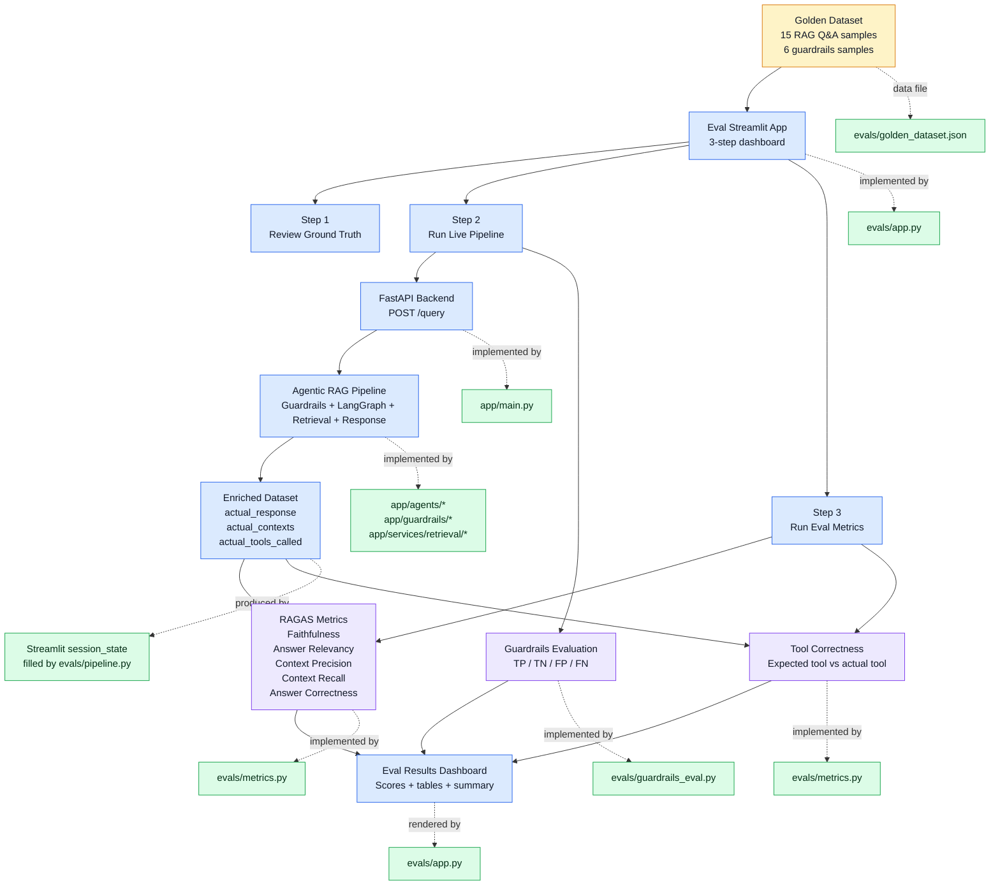

# kube-rag


Enterprise-grade agentic RAG over [Kubernetes](https://kubernetes.io/) documentation, with input guardrails, an LLM gateway, local reranking, full observability and an automated evaluation suite.

**What makes this repo worth reading is the evaluation.** Retrieval is scored on a 65-question golden set with no LLM judge, every label is backed by a quote that a test checks against the source, and each design change is measured before and after with paired confidence intervals. See [Results](#results).

## Features

- **Agentic pipeline (LangGraph):** a planner classifies intent, a retriever fetches and reranks context, and a responder generates the answer. Per-thread conversation memory is kept with `MemorySaver`.
- **Guardrails (NeMo Guardrails):** off-topic and jailbreak requests are blocked before they reach the pipeline.
- **LLM gateway (Portkey):** all generation goes through Portkey to Groq models. Fallback, retry and caching are enabled through a saved Portkey config.
- **Retrieval:** Qdrant vector search followed by a local FlashRank cross-encoder reranker.
- **Embeddings:** `sentence-transformers` (`all-mpnet-base-v2`, 768-dim) by default, with optional Gemini embeddings (`gemini-embedding-2-preview`, 3072-dim).
- **Ingestion:** PDF, HTML, DOCX, PPTX and TXT loaders, chunking, and indexing into Qdrant.
- **Observability:** Pydantic Logfire spans and LangSmith traces. Logfire is optional, and the app starts without it.
- **Evals:** RAGAS metrics, tool correctness and guardrail confusion-matrix scoring, run from a Streamlit dashboard.

## Architecture

```
Streamlit UI ──► FastAPI /query ──► NeMo Guardrails ──blocked──► refusal
                                          │ pass
                                          ▼
                              LangGraph: planner ─┬─ conversational ──► responder
                                                  └─ technical ──► retriever ─► responder
                                                                     │              │
                                                          Qdrant + FlashRank   Portkey ─► Groq
```

More detail: [`ARCHITECTURE.md`](ARCHITECTURE.md) and the guides in [`DOCS/`](DOCS/).

## Project structure

```
app/
  main.py                  FastAPI app (/, /health, /graph, /query)
  config.py                Settings read from environment variables
  agents/                  LangGraph graph, state and nodes (planner, retriever, responder)
  guardrails/              NeMo Guardrails setup and Colang rules
  gateway/                 Portkey client and LangChain LLM factory
  services/retrieval/      Embeddings, Qdrant service, FlashRank reranker
  ingestion/               Loaders, chunking and the ingestion CLI (processor.py)
ui/app.py                  Streamlit chat UI
evals/                     Golden dataset, pipeline runner, metrics, eval dashboard
DATA/                      Source documents (true_data, noisy_data)
processed_data/            Parsed JSON chunks
DOCS/                      Design docs and guides
Dockerfile                 Backend image
ui.Dockerfile              UI image
docker-compose.yml         Backend, UI and optional local Qdrant
```

## Prerequisites

- Python 3.11
- Docker and Docker Compose (for the containerised setup)
- A [Groq](https://console.groq.com/keys) API key
- A [Portkey](https://portkey.ai) API key with a Groq integration (this project uses the slug `@kube-rage-groq`)
- A Qdrant instance: Qdrant Cloud, or the local container (`--profile local`)
- Optional: Logfire token, LangSmith key, Gemini key

## Configuration

Copy the example file and fill it in:

```bash
cp .env.docker.example .env
```

| Variable | Required | Description |
|---|---|---|
| `GROQ_API_KEY` | yes | Groq key used by the guardrails and the gateway |
| `GROQ_FALLBACK_API_KEY` | no | Secondary Groq key |
| `PORTKEY_API_KEY` | yes | Portkey API key |
| `PORTKEY_GROQ_SLUG` | no | Portkey Groq integration slug (default `kube-rage-groq`) |
| `PORTKEY_CONFIG_ID` | no | Saved Portkey config ID (`pc-...`) enabling fallback, retry and cache. Without it, requests go straight to the primary model |
| `QDRANT_CLUSTER_ENDPOINT` | yes | Qdrant URL. Docker default is `http://qdrant:6333` |
| `QDRANT_API_KEY` | yes | Qdrant API key |
| `EMBEDDING_MODEL` | no | `sentence-transformers` (default) or `gemini` |
| `GEMINI_API_KEY` | if `gemini` | Gemini API key |
| `GROQ_MODEL` | no | Default `openai/gpt-oss-120b` |
| `LOGFIRE_TOKEN` | no | Enables Logfire |
| `LANGSMITH_TRACING`, `LANGSMITH_API_KEY`, `LANGSMITH_PROJECT`, `LANGSMITH_ENDPOINT` | no | LangSmith tracing |
| `JUDGE_GROQ` | evals | Separate Groq key for the eval judge, so eval runs don't use up the production key |
| `BACKEND_URL` | UI only | Backend URL. Set by docker-compose; set it yourself when running the UI outside Docker |

`.env.docker.example` doesn't list `PORTKEY_API_KEY`, `PORTKEY_GROQ_SLUG`, `PORTKEY_CONFIG_ID` or `JUDGE_GROQ`, so add them yourself.

### Models

Groq no longer lists `llama-3.1-8b-instant` or `llama-3.3-70b-versatile` for this project's key. The project now uses:

- Primary: `@kube-rage-groq/openai/gpt-oss-120b`
- Fallback (via saved config): `@kube-rage-groq/openai/gpt-oss-20b`
- Guardrails: `openai/gpt-oss-20b`

Check which models your key can use with `GET https://api.groq.com/openai/v1/models`.

### Portkey saved config

The Portkey workspace rejects inline configs, so create a saved one: Portkey dashboard → **Configs** → **Create**, paste the JSON below, save, and put the resulting `pc-...` ID in `.env` as `PORTKEY_CONFIG_ID`.

```json
{
  "strategy": {"mode": "fallback"},
  "cache": {"mode": "simple"},
  "retry": {"attempts": 2, "on_status_codes": [429, 503]},
  "targets": [
    {"override_params": {"model": "@kube-rage-groq/openai/gpt-oss-120b"}},
    {"override_params": {"model": "@kube-rage-groq/openai/gpt-oss-20b"}}
  ]
}
```

## Run with Docker

```bash
docker-compose up --build                   # backend + UI, using the Qdrant in your .env
docker-compose --profile local up --build   # also starts a local Qdrant container
```

| Service | URL |
|---|---|
| Streamlit UI | http://localhost:8501 |
| Backend API | http://localhost:8000 (container port 8080) |
| API docs | http://localhost:8000/docs |
| Local Qdrant (`local` profile) | http://localhost:6333 |

The first build takes several minutes (torch and the other dependencies), and the first start downloads the embedding and reranker models. The UI waits for the backend health check (`/health`) before starting.

## Run locally (without Docker)

```bash
python3.11 -m venv .venv && source .venv/bin/activate
pip install -r requirements.txt

uvicorn app.main:app --reload --port 8000                    # backend
BACKEND_URL=http://localhost:8000 streamlit run ui/app.py    # UI
```

## Ingest data

Put source documents in `DATA/true_data` (clean) or `DATA/noisy_data` (noisy), then run:

```bash
python -m app.ingestion.processor DATA/true_data true     # clean data only
python -m app.ingestion.processor DATA/noisy_data noisy   # add noisy data
```

Flags: `--wipe` drops and recreates the whole collection first. `--wipe-source` removes only the vectors for the source type being ingested. If you change `EMBEDDING_MODEL`, re-ingest with `--wipe`, because the vector dimensions differ (768 vs 3072). More examples in [`usefulCommands.md`](usefulCommands.md).

## API

| Method | Path | Description |
|---|---|---|
| GET | `/` | Welcome message |
| GET | `/health` | Health check, used by Docker |
| GET | `/graph` | PNG of the LangGraph workflow |
| POST | `/query` | Ask a question |

```bash
curl -X POST http://localhost:8000/query \
  -H 'Content-Type: application/json' \
  -d '{"q": "What is a Kubernetes pod?", "thread_id": "demo"}'
```

The response contains `question`, `answer`, `thought_process` (the steps taken), `status` and `sources`. Reuse the same `thread_id` to keep conversation memory. If the pipeline fails, the endpoint still returns HTTP 200 with `"status": "error"`.

## Results

Retrieval quality on a **65-question golden set** over six documents, mixed with about 60 unrelated PDFs, `.docx` and `.pptx` files that act as distractors. No LLM judge is involved. A question counts as a hit when a chunk from a gold source file is in the top 5. Every gold label is backed by a verbatim quote from the source, and a test checks each quote against the parsed text. Intervals are 95% bootstrap intervals over questions.

| Configuration | hit@5 | MRR@5 |
|---|---|---|
| Retriever only, with FlashRank reranker | 1.000 | 0.951 (0.910 to 0.985) |
| Retriever only, no reranker | 0.923 (0.846 to 0.985) | 0.845 (0.765 to 0.918) |
| Planner + retriever, searches with the user's own words on a first question (current) | 1.000 | 0.951 (0.910 to 0.985) |
| Planner + retriever, always searches with the planner's rewrite (previous behaviour) | 0.969 (0.923 to 1.000) | 0.862 (0.800 to 0.923) |
| Full API: guardrails + planner + retriever + answer | 0.969 (0.923 to 1.000) | 0.869 (0.808 to 0.923) |

**What the measurements say**

- **The reranker helps.** Paired on the same 65 questions, FlashRank adds +0.077 hit@5 (95% CI +0.015 to +0.138) and +0.106 MRR (CI +0.026 to +0.188). It fixed 5 questions on hit@5 and broke none.
- **The planner's query rewrite hurt.** It padded questions with generic words ("Kubernetes ... documentation"), pushing the right document from rank 1 to rank 2. Searching with the user's own words on a first question recovered +0.090 MRR (CI +0.038 to +0.144). The rewrite is still used on follow-up questions, where it resolves references.
- **Repairing the rewrite's malformed output changed nothing.** 29 of 75 rewrites had duplicated text, stray null characters or web-search operators. Cleaning them left hit@5 unchanged on all 65 questions, so the content of the rewrite, not its formatting, was the problem.
- **The prompt, not a score threshold, handles questions the corpus cannot answer.** 9 of 10 unanswerable questions were refused (Wilson 95% interval about 0.60 to 0.98), including three whose retrieval scores were 0.86 to 0.997. The one failure adapted an egress NetworkPolicy example into an ingress one using outside knowledge.

**Limits. Read these before quoting any number.**

- 65 questions, written by reading the documents, so many are close to verbatim lookups. A hit@5 of 1.000 means the set can no longer separate good from better, not that retrieval is perfect. The bootstrap interval collapses to zero width at 100%; a conservative lower bound is about 0.95 (the rule of three, 1 − 3/65).
- Two labels (Q038, Q039) were corrected after results existed, because the retriever returned a document that also contains the answer. Each added source was checked against the text, the change is recorded in the `changelog` of `evals/golden_v2.json`, and every saved run was rescored with `evals.rescore`. A search of the rest of the corpus found no further missing sources.
- Single-turn questions only. Whether keeping the planner's rewrite for follow-ups helps is not measured.
- Refusal is measured on 10 questions, so the interval is wide.
- Answer quality (RAGAS faithfulness and relevancy) exists in the dashboard but has not been run on this golden set.
- The first full API run failed on 28 of 75 questions when Groq's daily token limit on the guardrail model was reached. The runner now records failures separately, retries, stops after repeated failures, and resumes; the reported API run is the completed one.

**Reproduce**

```bash
python -m evals.run_retrieval_eval --label baseline-dense --mode retriever              # needs Qdrant and the embedding model, no LLM
python -m evals.run_retrieval_eval --label agent-followups --mode agent                 # real planner + retriever, no guardrails
python -m evals.run_retrieval_eval --label baseline-api --mode api [--resume]           # full path; limited by LLM quotas
python -m evals.compare baseline-dense baseline-dense-norerank                          # paired difference with 95% interval
python -m evals.rescore baseline-dense --write                                          # rescore after a label change
python -m evals.build_golden_v2                                                         # rebuild and verify the golden set
```

Saved runs are in `evals/results/`; the design notes are in [`DOCS/`](DOCS/).

## Tests and CI

```bash
pip install -r requirements-ci.txt
python -m pytest tests -q
```

The tests stub Qdrant, the reranker, the LLM gateway and the planner, so they need no API keys, no `.env` and no PyTorch. The same command runs in GitHub Actions on every pull request. CI cannot re-run retrieval, so it also checks that the committed results use the current gold labels and stay above a conservative floor.

## Evaluation

The eval dashboard runs the original golden dataset (15 RAG Q&A samples and 6 guardrail samples) against the live backend and scores it with RAGAS. The retrieval results above use the newer `evals/golden_v2.json` set instead.

```bash
streamlit run evals/app.py
```

Metrics: RAGAS faithfulness, answer relevancy, context precision, context recall and answer correctness; tool correctness (expected vs actual tool); and guardrail TP/TN/FP/FN. The judge uses `JUDGE_GROQ`. Details: [`DOCS/10_EVALS.md`](DOCS/10_EVALS.md) and [`DOCS/11_EVALS_PIPELINE.md`](DOCS/11_EVALS_PIPELINE.md).



## Troubleshooting

| Symptom | Cause and fix |
|---|---|
| `ModuleNotFoundError` on backend start | A package is missing from `requirements-prod.txt` (the file the backend image installs from) |
| `Missing credentials` from `ChatOpenAI` | `PORTKEY_API_KEY` isn't reaching the container. Check `.env` and `docker-compose.yml` |
| `model_not_found` (404) from Groq | The model was retired or isn't enabled for your key. Pick one from `GET /openai/v1/models` |
| Portkey 400 "inline configs disabled" | Create a saved config and set `PORTKEY_CONFIG_ID` |
| UI shows "connection refused" | The backend wasn't ready yet. Wait for it to become healthy |

More in [`DOCS/06_KNOWN_GOTCHAS.md`](DOCS/06_KNOWN_GOTCHAS.md).

## Documentation

All design docs are in [`DOCS/`](DOCS/): system overview, ingestion engine, node intelligence, tracing, environment variables, gotchas, FlashRank reranking, guardrails, LLM gateway and evals.
